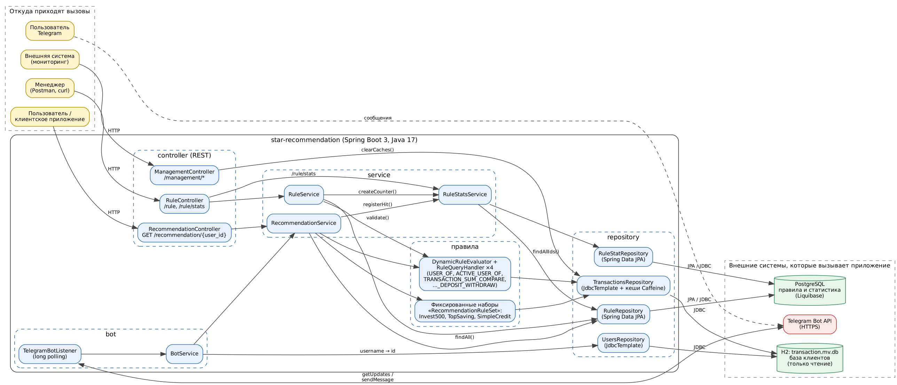
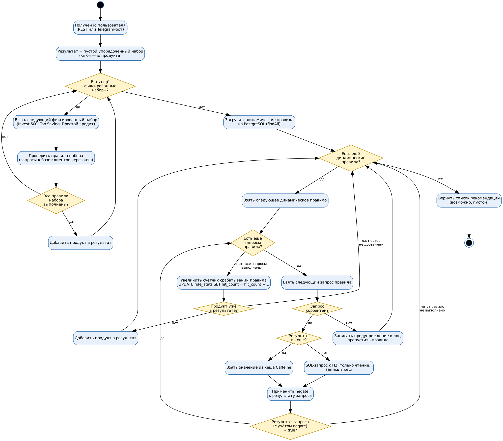

# Архитектура

## Диаграмма компонентов



Исходник: [`components.dot`](../diagrams/components.dot) (Graphviz).

**Откуда приходят вызовы**

- Клиентские приложения (Пользователь) вызывают `GET /recommendation/{user_id}`.
- Менеджер работает с `/rule` и `/rule/stats` (Postman, curl и т. п.).
- Внешняя система вызывает `/management/clear-caches` и `/management/info`.
- Пользователь Telegram пишет боту; приложение само опрашивает Telegram Bot API (long polling, метод `getUpdates`)
  и отвечает через `sendMessage`. Входящих соединений от Telegram нет: сервису не нужен публичный адрес.

**Какие внешние системы вызывает приложение**

| Система | Что хранит / делает | Доступ |
|---------|--------------------|--------|
| H2 (`transaction.mv.db`) | Клиенты, продукты и операции. Данные не меняются | JDBC (`JdbcTemplate`), только чтение |
| PostgreSQL | Динамические правила и счётчики срабатываний | Spring Data JPA, схема — Liquibase |
| Telegram Bot API | Приём сообщений и отправка ответов бота | HTTPS, только если задан токен |

## Описание компонентов

| Слой | Компонент | Ответственность |
|------|-----------|----------------|
| controller | `RecommendationController` | `GET /recommendation/{user_id}` |
| | `RuleController` | `POST/GET /rule`, `GET /rule/stats`, `DELETE /rule/{id}` |
| | `ManagementController` | `POST /management/clear-caches`, `GET /management/info` |
| | `ApiExceptionHandler` | Ошибки валидации и некорректные правила превращаются в ответ 400 |
| bot | `TelegramBotListener` | Получает сообщения Telegram и отправляет ответы |
| | `BotService` | Логика бота без привязки к Telegram: приветствие, разбор команды, поиск пользователя |
| service | `RecommendationService` | Собирает рекомендации: фиксированные наборы, затем динамические правила; считает срабатывания |
| | `RuleService` | Создаёт (с проверкой), показывает и удаляет правила |
| | `RuleStatsService` | Создаёт нулевой счётчик, атомарно увеличивает его, формирует статистику |
| правила | `RecommendationRuleSet` и три реализации | Фиксированные правила из ТЗ №1: один класс — одна рекомендация |
| | `DynamicRuleEvaluator`, `RuleQueryHandler` | Проверка и вычисление динамических правил; по одному обработчику на тип запроса |
| repository | `TransactionsRepository` | Два параметризованных запроса к базе клиентов с кешами Caffeine |
| | `UsersRepository` | Поиск пользователей по `username` |
| | `RuleRepository`, `RuleStatRepository` | JPA-репозитории правил и счётчиков |

### Данные динамических правил

```
rules(id, product_name, product_id, product_text)
  └─< rule_queries(id, rule_id → rules, query_order, query_type, negate)
        └─< rule_query_arguments(query_id → rule_queries, arg_order, argument)
rules ──1:1── rule_stats(id, rule_id → rules ON DELETE CASCADE, hit_count)
```

Правило — это упорядоченный список запросов; все запросы объединяются по «И». Миграции — в
`src/main/resources/db/changelog`.

## Диаграмма деятельности: выдача рекомендаций



Исходник: [`activity-recommendation.dot`](../diagrams/activity-recommendation.dot) (Graphviz).

Ключевые моменты алгоритма:

1. **Сначала фиксированные правила** (Invest 500, Top Saving, Простой кредит), затем **динамические** из PostgreSQL.
2. Каждый запрос динамического правила вычисляется через кеш Caffeine; при промахе выполняется SQL к H2 и результат
   запоминается. После вычисления применяется `negate`.
3. Если хотя бы один запрос дал `false`, правило не выполнено и проверка переходит к следующему правилу (короткое
   замыкание — остальные запросы не вычисляются).
4. Когда правило выполнено, счётчик срабатываний увеличивается на 1 — даже если такой продукт уже есть в ответе
   (повторно он в ответ не попадает). Продукты различаются по `product_id`.
5. Повреждённое правило (неизвестный тип запроса, неверные аргументы) пропускается с записью в лог.

Бот использует тот же алгоритм: сначала находит пользователя по `username` (ровно один — выдаёт рекомендации,
иначе «Пользователь не найден»), затем вызывает `RecommendationService`.

## Как расширять сервис

**Новый тип запроса для динамических правил** (например, `USER_OF_ANY`):

1. Добавьте значение в `QueryType`.
2. Создайте класс `@Component`, наследующий `AbstractRuleQueryHandler` (интерфейс `RuleQueryHandler`):
   `type()` возвращает новое значение, `validate()` проверяет аргументы (выбрасывает `InvalidRuleException`),
   `evaluate()` вычисляет результат (без учёта `negate` — его применяет `DynamicRuleEvaluator`).
3. Если нужен новый SQL, добавьте метод в `TransactionsRepository` с отдельным кешем (ключ — все параметры).
4. Добавьте тест по образцу `DynamicRuleEvaluatorTest` и опишите тип в [OpenAPI](../openapi.yaml).

`DynamicRuleEvaluator` подхватит обработчик автоматически: он собирает все бины `RuleQueryHandler`.

**Новое фиксированное правило**: класс `@Component`, реализующий `RecommendationRuleSet`
(`Optional<RecommendationDto> check(UUID userId)`), по образцу `SimpleCreditRuleSet`. Запросы к базе делайте через
`TransactionsRepository`, чтобы использовался кеш.

**Новая команда бота**: добавьте ветку в `BotService.handle` — класс не зависит от Telegram и тестируется обычным
модульным тестом.

## Ограничения

- База клиентов — файл H2, который одновременно открывает один процесс. Поэтому сервис запускается в одном экземпляре
  (и файл не должен быть открыт в DBeaver).
- Кеш рекомендаций не истекает по времени (данные клиентов не меняются): после обновления файла базы вызовите
  `POST /management/clear-caches`.
- Динамические правила читаются из PostgreSQL при каждом запросе рекомендаций, поэтому изменения правил
  применяются сразу.
