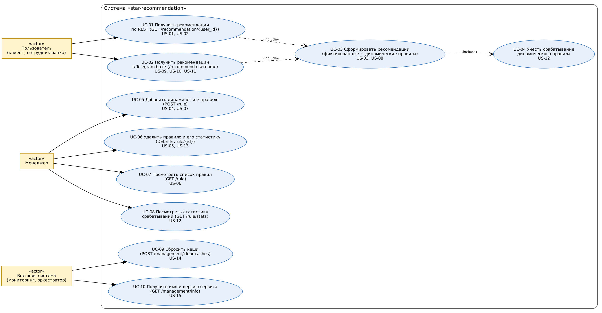

# Требования

Требования записаны в формате **User Story** («Как [роль], я хочу [действие], чтобы [польза]») и дополнены
**нефункциональными требованиями**. У каждого требования есть идентификатор: `US-xx` для функциональных,
`NFR-xx` для нефункциональных. Привязка к задачам GitHub — в [таблице трассировки](Traceability.md).

## Акторы

| Актор | Кто это | Как взаимодействует |
|-------|---------|---------------------|
| **Пользователь** | Клиент или сотрудник банка | Получает рекомендации через REST API и Telegram-бота |
| **Менеджер** | Сотрудник маркетинга | Управляет динамическими правилами и смотрит статистику их срабатываний |
| **Внешняя система** | Мониторинг, оркестратор, общий список сервисов банка | Сбрасывает кеши и запрашивает информацию о сервисе |

## Диаграмма вариантов использования

Исходник диаграммы: [`use-case.dot`](../diagrams/use-case.dot) (Graphviz).

## Функциональные требования (User Story)

### Рекомендации (ТЗ №1)

| ID | User Story | Критерии приёмки |
|----|-----------|------------------|
| **US-01** | Как **Пользователь**, я хочу получить по своему идентификатору список рекомендованных продуктов (`GET /recommendation/{user_id}`), чтобы узнать, какие предложения банка мне подходят. | Ответ 200 и JSON `{"user_id": ..., "recommendations": [{"name", "id", "text"}]}`; формат и пути строго по ТЗ. |
| **US-02** | Как **Пользователь**, я хочу получить пустой список вместо ошибки, если мне пока ничего не подходит, чтобы клиентское приложение работало одинаково во всех случаях. | Ответ 200, `recommendations: []`. |
| **US-03** | Как **Менеджер**, я хочу, чтобы продукты Invest 500, Top Saving и «Простой кредит» рекомендовались по заданным правилам сразу после запуска сервиса, чтобы не заводить их вручную. | Для тестовых пользователей из ТЗ выдаются соответствующие продукты; правила объединяются по «И». |

### Динамические правила (ТЗ №2)

| ID | User Story | Критерии приёмки |
|----|-----------|------------------|
| **US-04** | Как **Менеджер**, я хочу добавить новое правило рекомендации (`POST /rule`), чтобы запустить новый продукт без изменения кода. | Правило сохраняется в БД, ответ 200 содержит правило с присвоенным `id`. Некорректное правило отклоняется с кодом 400 и понятным сообщением. |
| **US-05** | Как **Менеджер**, я хочу удалить правило (`DELETE /rule/{id}`), чтобы убрать устаревший продукт из рекомендаций. | Ответ 204; принимается `id` правила или `product_id` продукта. |
| **US-06** | Как **Менеджер**, я хочу видеть список всех правил (`GET /rule`), чтобы контролировать, что рекомендует система. | Ответ 200, `{"data": [...]}`. |
| **US-07** | Как **Менеджер**, я хочу описывать правила набором запросов четырёх типов (`USER_OF`, `ACTIVE_USER_OF`, `TRANSACTION_SUM_COMPARE`, `TRANSACTION_SUM_COMPARE_DEPOSIT_WITHDRAW`) с модификатором `negate`, чтобы выразить нужные условия. | Правило выполняется, если все его запросы вернули `true`; допустимые операции сравнения: `>`, `<`, `=`, `>=`, `<=`. |
| **US-08** | Как **Пользователь**, я хочу получать рекомендации и по динамическим, и по фиксированным правилам, чтобы видеть полный список предложений. | Продукт не повторяется в ответе; несколько правил одного продукта работают как «ИЛИ». |

### Telegram-бот (ТЗ №3)

| ID | User Story | Критерии приёмки |
|----|-----------|------------------|
| **US-09** | Как **Пользователь**, я хочу, чтобы при первом обращении бот поздоровался и показал справку, чтобы понять, как им пользоваться. | Приветствие и справка также по `/start` и `/help`. |
| **US-10** | Как **Пользователь**, я хочу получить рекомендации командой `/recommend username`, чтобы не знать свой технический идентификатор. | Ответ: «Здравствуйте Имя Фамилия», «Новые продукты для вас:» и список продуктов с маркерами. |
| **US-11** | Как **Пользователь**, я хочу получить понятное сообщение «Пользователь не найден», если имя неизвестно или неоднозначно, чтобы исправить запрос. | Сообщение при 0 и при более чем 1 найденном пользователе. |

### Статистика (ТЗ №3)

| ID | User Story | Критерии приёмки |
|----|-----------|------------------|
| **US-12** | Как **Менеджер**, я хочу получить число срабатываний каждого динамического правила (`GET /rule/stats`), чтобы понимать, какие правила работают. | Ответ 200, `{"stats": [{"rule_id", "count"}]}`; правила без срабатываний присутствуют со значением 0; счётчик растёт на 1 при каждой выданной рекомендации. |
| **US-13** | Как **Менеджер**, я хочу, чтобы статистика удалялась вместе с правилом, чтобы в отчётах не оставалось «мусора». | После удаления правила его нет в `/rule/stats`. |

### Служебные методы (ТЗ №3)

| ID | User Story | Критерии приёмки |
|----|-----------|------------------|
| **US-14** | Как **Внешняя система**, я хочу сбросить закешированные результаты (`POST /management/clear-caches`), чтобы сервис увидел обновлённые данные. | POST без тела, ответ 200; следующие запросы снова обращаются к базе. |
| **US-15** | Как **Внешняя система**, я хочу получить имя и версию сервиса (`GET /management/info`), чтобы отображать сервис в общем списке сервисов банка. | JSON `{"name", "version"}`, значения берутся из `pom.xml`. |

## Нефункциональные требования

| ID | Категория | Требование | Как проверяется |
|----|-----------|-----------|-----------------|
| **NFR-01** | Производительность | Результаты SQL-запросов к базе клиентов кешируются (Caffeine, по одному кешу на метод репозитория, ключ — все параметры запроса). Запросы параметризованные, общие для всех правил. Повторный запрос рекомендаций для того же пользователя не обращается в базу клиентов. | `TransactionsRepositoryTest`: второй вызов не ходит в БД; ручная проверка — второй запрос быстрее первого. |
| **NFR-02** | Целостность и надёжность данных | Инкремент счётчика срабатываний атомарный (один SQL `UPDATE`), при параллельных запросах срабатывания не теряются. Статистика удаляется каскадно вместе с правилом (внешний ключ `ON DELETE CASCADE`). Таблицы создаются только миграциями Liquibase. База клиентов открывается только для чтения. | `RuleStatsServiceTest`, миграции `db/changelog`; настройка `readOnly` у источника данных H2. |
| **NFR-03** | Логирование и обработка ошибок | Некорректный запрос на создание правила отклоняется с кодом 400 и описанием причины. Повреждённое сохранённое правило не ломает выдачу: оно пропускается, предупреждение пишется в лог. Ошибка при обработке одного сообщения Telegram логируется и не останавливает бота. | `DynamicRuleEvaluatorTest`, `RecommendationServiceTest`; код `ApiExceptionHandler`, `TelegramBotListener`. |
| **NFR-04** | Безопасность конфигурации | Токен Telegram-бота и пароль БД не хранятся в репозитории: задаются переменными среды (`TELEGRAM_BOT_TOKEN`, `SPRING_DATASOURCE_PASSWORD`). Без токена сервис работает без бота. | Файл `.gitignore`, раздел «Развёртывание». |
| **NFR-05** | Сопровождаемость и расширяемость | Новый тип запроса динамического правила или новое фиксированное правило добавляется новым классом с `@Component`, без изменения существующей логики. Компоненты покрыты модульными тестами (JUnit, Mockito). | Раздел «Как расширять сервис» в [Архитектуре](Architecture.md); `mvn test`. |
| **NFR-06** | Совместимость интерфейсов | Пути, методы и поля REST API соответствуют техническим заданиям без изменений. | [OpenAPI-описание](REST-API.md). |
